# 🚀 Distributed Library System

### An Event-Driven, Domain-Driven and Cloud-Native Architecture

<p align="center">
  <b>Production-inspired Distributed Architecture using Domain Events, Event-Carried State Transfer, CQRS and Kubernetes</b><br/>
  <i>Designed around Domain-Driven Design to achieve loose coupling, eventual consistency, and independently scalable microservices</i>
</p>

---

<p align="center">


</p>

---

## 🎬 System Demo

**Real-time distributed workflow:** Borrow → Kafka → Asynchronous Processing → Analytics Ranking Update

<p align="center">
  <a href="https://github.com/damouu/distributed-library-system/issues/2#issue-4280105326">
    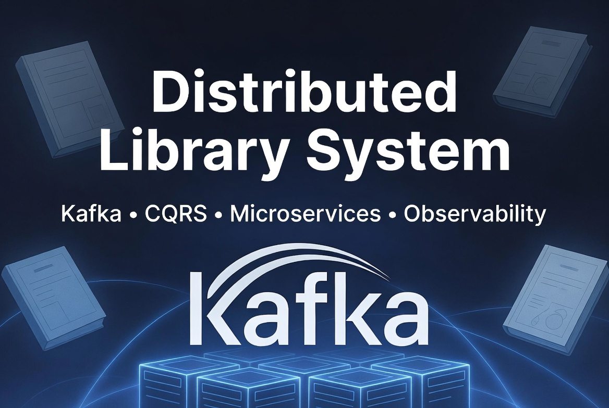
  </a>
</p>

<p align="center">
  
</p>

**Click the image above to watch the full demo.**

---

## 🏛️ Architecture Overview

The following diagram illustrates the overall system architecture, including bounded contexts, asynchronous event flows, external managed services, and the Kubernetes deployment topology.

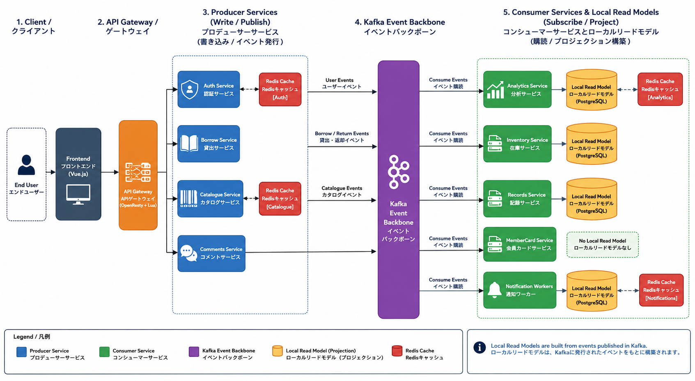

---

## 💡 Why Version 2?

Version 1 successfully demonstrated an event-driven architecture using Apache Kafka, CQRS, and asynchronous communication between microservices. It provided a solid foundation for modeling a distributed library system and validating the overall architecture.

However, as the system evolved, several architectural limitations became apparent.

The most significant issue was that event payloads were designed around the needs of downstream consumers rather than around the Borrow domain itself. Events contained service-specific structures such as `notification_data` and `inventory_data`, meaning the Borrow Service had explicit knowledge of how other services consumed its events.

This approach created unnecessary coupling between bounded contexts. Every time a new consumer required additional information, or an existing consumer changed its requirements, the Borrow Service had to be modified. As a result, a single business event became responsible for satisfying multiple independent services.

Version 2 was created to address these architectural limitations.

The event model was redesigned following **Domain-Driven Design (DDD)** principles and the **Event-Carried State Transfer (ECST)** pattern. Instead of publishing consumer-oriented payloads, each producer now emits only the business facts belonging to its own domain.

Consumers are now fully responsible for interpreting events and building their own **Local Projections** optimized for their specific use cases. This removes producer knowledge of downstream services, significantly reduces coupling, and allows new consumers to subscribe to existing events without requiring changes to the event producer.

Another important evolution was extending event production beyond the Borrow and Auth services. In Version 2, additional bounded contexts such as the Catalogue Service also became Kafka event producers, allowing each domain to publish its own business events independently.

Beyond the communication model, Version 2 also modernizes the deployment architecture by moving from a Docker Compose environment to Kubernetes, externalizing databases to managed cloud services, and improving observability through OpenTelemetry, Jaeger, Prometheus, and Grafana.

Rather than introducing new technologies for their own sake, Version 2 represents an architectural refinement driven by lessons learned while building Version 1. The objective was to move closer to production-grade distributed system design by improving domain boundaries, reducing coupling, and increasing long-term maintainability.

---

## 🔄 Evolution: Version 1 → Version 2

Version 2 is not a complete rewrite of the project, but an architectural evolution driven by lessons learned while building Version 1. Each change was introduced to improve maintainability, scalability, and adherence to Domain-Driven Design (DDD) principles.

### 1️⃣ Why the redesign?

| Version 1 | Version 2 |
|:----------|:----------|
| Working architecture | Production-oriented architecture |
| Proof of concept | Domain-oriented redesign |
| Event-driven | Event-driven + ECST (Event-Carried State Transfer) |
| Functional | Better maintainability |

### 2️⃣ Architectural differences

| Area | Version 1 | Version 2 |
|:-----|:----------|:----------|
| **Communication** | Kafka Events | Kafka Domain Events |
| **Event Design** | Consumer-oriented | Domain-oriented |
| **Producer Knowledge** | Knows consumers | Consumer agnostic |
| **Data Ownership** | Partially shared | Strict bounded contexts |
| **Deployment** | Docker Compose | Kubernetes |
| **Databases** | Local containers | Managed cloud databases |
| **Observability** | Basic | OpenTelemetry + Jaeger |

**Version 1 (Coupled Architecture)**

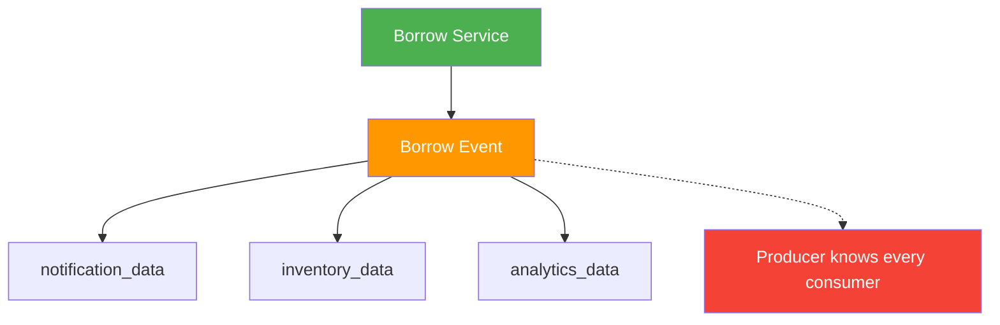

**Version 2 (Decoupled & Event-Driven)**

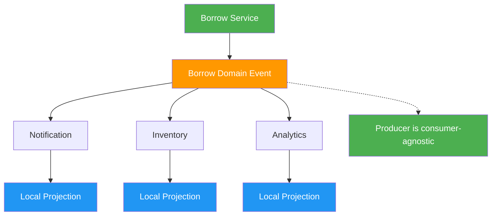

### 3️⃣ Event Payload Evolution

**Version 1 Payload (Consumer-Oriented Event)**

```json
{
  "metadata": {
    "timestamp": "2026-04-17",
    "memberCardUUID": "64575088-afaf-4684-9b9f-37f77e2a6214",
    "source_service": "library-app-borrow-v1",
    "event_type": "LIBRARY_BORROWED",
    "event_uuid": "800db7e6-0394-4b2d-86c2-28337368fa91"
  },
  "data": {
    "notification_data": {
      "borrow_uuid": "800db7e6-0394-4b2d-86c2-28337368fa91",
      "borrow_start_date": "2026-04-17",
      "borrow_end_date": "2026-05-01",
      "chapters": [
        {
          "chapter_title": "Chainsaw Man",
          "chapter_number": 1,
          "chapter_uuid": "a93038dc-5aee-494c-ad0c-6795c75567d0",
          "chapter_second_title": "Chainsaw Man",
          "chapter_cover_url": "https://m.media-amazon.com/images/I/71YNo-m85oL._SL1200_.jpg"
        }
      ]
    },
    "inventory_data": {
      "books": [
        {
          "book_uuid": "9e583a0b-caba-416e-8a0f-b1da2db495b1"
        }
      ]
    }
  }
}
```

#### Problems with Version 1

- The producer knew every consumer and their specific data requirements.
- Event payloads grew over time as new consumer requirements emerged.
- Events were not reusable by new, unknown services.
- Bounded Context boundaries were violated by including consumer-specific data, such as book titles inside a Borrow event.

**Version 2 Payload (Domain Event)**

```json
{
  "metadata": {
    "timestamp": "2026-06-10T14:36:05.424117357",
    "source_service": "library-app-borrow-v1",
    "event_type": "LIBRARY_BORROWED",
    "event_uuid": "58ae2d2f-abe0-4b73-8921-f7c15b0c322c"
  },
  "data": {
    "member_card_uuid": "9d95a26b-6d6c-4dea-b25b-1ffb8eee9d75",
    "borrow_uuid": "58ae2d2f-abe0-4b73-8921-f7c15b0c322c",
    "borrow_start_date": "2026-06-10",
    "borrow_end_date": "2026-06-24",
    "borrowed_items": [
      {
        "book_uuid": "dfb567f6-233b-4eba-8b7c-1e252a4eac17",
        "chapter_uuid": "15d4a9c8-3fa7-444e-b9a7-080658f214e4"
      },
      {
        "book_uuid": "f2327615-8f14-4192-ab0b-2b13795dbe2a",
        "chapter_uuid": "81fa2250-0b87-47b8-8e90-9643ae22a9e5"
      }
    ]
  }
}
```

#### Improvements

- Contains only domain-level business facts.
- Reusable by every consumer.
- Follows the Event-Carried State Transfer (ECST) pattern.
- The producer is completely independent and consumer-agnostic.

#### Conclusion

The Borrow Service no longer publishes consumer-specific data tailored for Notification or Inventory. It simply publishes a pure, lightweight borrowing event.

### 4️⃣ Evolution of Event Producers

| Producer | Version 1 | Version 2 |
|:---------|:---------:|:---------:|
| **Auth** | ✅ | ✅ |
| **Borrow** | ✅ | ✅ |
| **Catalogue** | ❌ | ✅ |

**Version 1:** Auth & Borrow

**Version 2:** Auth, Borrow & Catalogue

**Future:** Recommendations, Payments, Invoices...

Every bounded context is responsible for publishing the events belonging to its own domain.

### 5️⃣ Infrastructure Evolution

| Component | Version 1 | Version 2 |
|:----------|:---------:|:---------:|
| **Docker Compose** | ✅ | ❌ |
| **Kubernetes** | ❌ | ✅ |
| **PostgreSQL Containers** | ✅ | ❌ |
| **Neon (Managed DB)** | ❌ | ✅ |
| **MongoDB Local** | ✅ | ❌ |
| **MongoDB Atlas** | ❌ | ✅ |
| **Mailpit** | ✅ | ❌ |
| **Resend** | ❌ | ✅ |
| **OpenTelemetry** | Partial | Complete |
| **Prometheus** | ✅ | ✅ |
| **Jaeger** | ✅ | ✅ |
| **Caching** | ❌ | Domain-specific |

Version 2 focuses not only on improving application architecture but also on aligning the deployment and operational model with production-oriented distributed systems.

Kubernetes, managed databases, centralized observability, and domain-driven event communication collectively move the project closer to real-world backend architectures.

---

## 🏛️ ☸️ Kubernetes Cluster Architecture

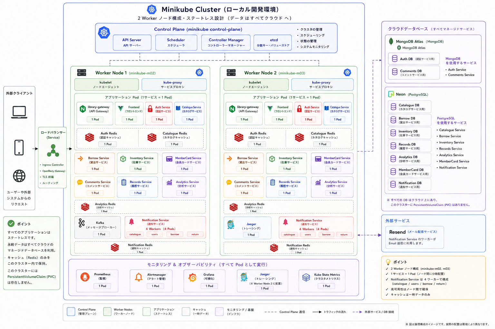

Version 2 migrates from a Docker Compose deployment to a cloud-native Kubernetes architecture designed for horizontal scalability and operational resilience.

### ⚡ Key Architectural Highlights

- **100% Stateless Design (Zero PVCs):**

  All application pods are completely stateless. There are no `PersistentVolumeClaims` (PVCs) within the cluster.

  Stateful data has been entirely offloaded to managed cloud databases (Neon for PostgreSQL, MongoDB Atlas). This allows pods to be terminated, scaled, or rescheduled without risking the loss of persistent application data.

- **Decoupled Analytics & Real-Time Traffic:**

  An event-driven pipeline strictly separates real-time user interactions from analytical workloads.

  When a user borrows a book, computationally intensive operations, such as ranking recalculation, are handled asynchronously by the Analytics pods, ensuring that user-facing latency is not directly impacted by background computations.

- **Dedicated Worker Node Distribution:**

  Services are distributed across two independent worker nodes (`minikube-m02` and `minikube-m03`) to improve workload distribution and availability.

  Redis caches are also distributed across individual domains.

- **Fine-Grained Consumer Scaling:**

  The Notification Service is deployed as four independent worker pods (`catalogue`, `users`, `borrow`, `return`), allowing specific event consumers to scale independently according to workload.

- **Embedded Observability:**

  The cluster hosts its own monitoring and tracing infrastructure, including Prometheus, Grafana, and Jaeger, collecting metrics directly from Kubernetes resources and application pods.

---

## 🏗️ Core Architectural Patterns

Version 2 moves away from traditional synchronous REST/gRPC inter-service calls, relying instead on a robust asynchronous event-driven backbone.

| Pattern | Purpose |
|:--------|:--------|
| **Event-Driven Architecture** | Asynchronous communication |
| **Event-Carried State Transfer (ECST)** | Carry business state through events |
| **Local Projections** | Consumer autonomy |
| **CQRS** | Read / Write separation |
| **Eventual Consistency** | Distributed consistency |
| **Fan-out** | Multiple independent consumers |
| **Domain Events** | Immutable business facts |

---

## 🔗 Domain Events

This section outlines the asynchronous domain events published by each microservice. These events facilitate loosely coupled communication across the architecture using Kafka as the message broker.

| Bounded Context | Producer | Published Events |
|:----------------|:---------|:-----------------|
| **Borrowing Context** | Borrow | `LIBRARY_BORROWED`, `LIBRARY_RETURNED` |
| **Identity & Access Context** | Auth | `USER_CREATED`, `USER_UPDATED` |
| **Catalog Context** | Catalogue | `CHAPTER_CREATED`, `CHAPTER_UPDATED` |

### Architectural Patterns & Rationale

The following patterns are implemented to improve resilience, scalability, and loose coupling across services.

| Pattern | Why It Was Introduced |
|:--------|:----------------------|
| **Event-Driven Architecture** | Decouple services through asynchronous communication |
| **Event-Carried State Transfer** | Reduce synchronous service-to-service queries |
| **Local Projections** | Allow each service to own its read model |
| **CQRS** | Separate write and read responsibilities |
| **Eventual Consistency** | Support distributed workflows |
| **Fan-out** | Allow one event to drive multiple business processes |
| **Domain Events** | Publish immutable business facts owned by each bounded context |

---

## 🔗 Service Architecture

| Service | Tech Stack | Responsibility | Role | GitHub Repository |
|:--------|:-----------|:---------------|:-----|:------------------|
| **UI** | Vue.js | Frontend | Frontend Client | [library-app-ui](https://github.com/damouu/library-app-ui) |
| **Gateway** | OpenResty | Routing | API Gateway | [library-app-gateway](https://github.com/damouu/library-app-gateway) |
| **Auth** | Laravel | Authentication | Auth Service | [library-app-auth](https://github.com/damouu/library-app-auth) |
| **Catalogue** | Spring Boot | Catalog | Event Producer | [library-app-catalogue](https://github.com/damouu/library-app-catalogue) |
| **Borrow** | Spring Boot | Borrowing | Command Service | [library-app-borrow](https://github.com/damouu/library-app-borrow) |
| **Inventory** | Spring Boot | Inventory | Projection Builder | [library-app-inventory](https://github.com/damouu/library-app-inventory) |
| **Analytics** | Spring Boot | Rankings | Projection Builder | [library-app-analytics](https://github.com/damouu/library-app-analytics) |
| **Notification** | Laravel | Emails | Event Consumer | [library-app-notification](https://github.com/damouu/library-app-notification) |
| **Comments** | Node.js | Comments | Comments Service | [library-app-comments](https://github.com/damouu/library-app-comments) |
| **Records** | Spring Boot | Read Model (CQRS) | CQRS Read Model | [library-app-records](https://github.com/damouu/library-app-records) |
| **MemberCard** | Spring Boot | Membership Management | Membership Service | [library-app-membercard](https://github.com/damouu/library-app-membercard) |

---

## 🔍 Observability

Version 2 embeds observability as a first-class architectural concern through OpenTelemetry, Jaeger, Prometheus, and Grafana.

These tools provide end-to-end visibility across synchronous requests and asynchronous Kafka event processing, making distributed workflows easier to understand, debug, and monitor.

### Observability Stack

```text
Observability
│
├── OpenTelemetry
├── Jaeger
├── Prometheus
├── Grafana
└── Distributed Tracing
```

### Jaeger Dependency Graph

The dependency graph generated by Jaeger provides a high-level view of the interactions between microservices.

It automatically discovers service relationships from distributed traces, making it easier to understand communication paths and identify potential bottlenecks within the system.

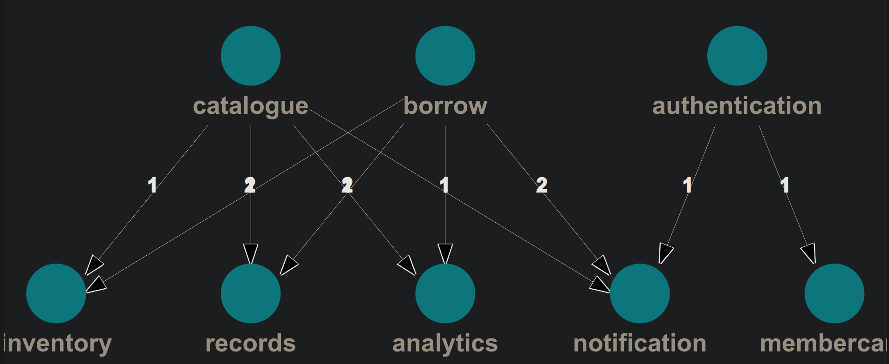

### Catalogue Service — Distributed Trace

The following trace captures the complete request lifecycle when a new chapter is created through the Catalogue Service.

It shows how a single business operation propagates across multiple services while maintaining trace context throughout the distributed system.

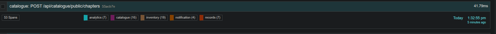

### Asynchronous Event Propagation

Once the Catalogue Service publishes a domain event, multiple consumers process it independently.

Jaeger visualizes the complete asynchronous execution flow, allowing Kafka event propagation across bounded contexts to be traced from producer to consumer.

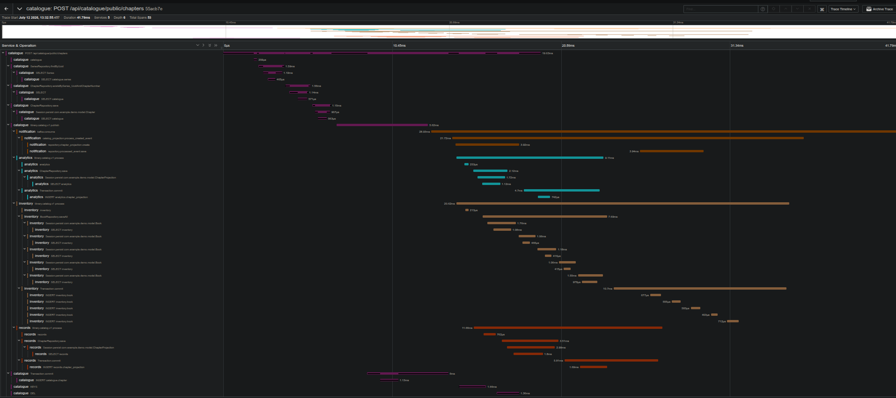

### Grafana Monitoring

Grafana dashboards provide real-time operational metrics collected by Prometheus.

The following dashboard illustrates the HTTP traffic handled by the Borrow Service, enabling request monitoring, performance analysis, and operational troubleshooting.

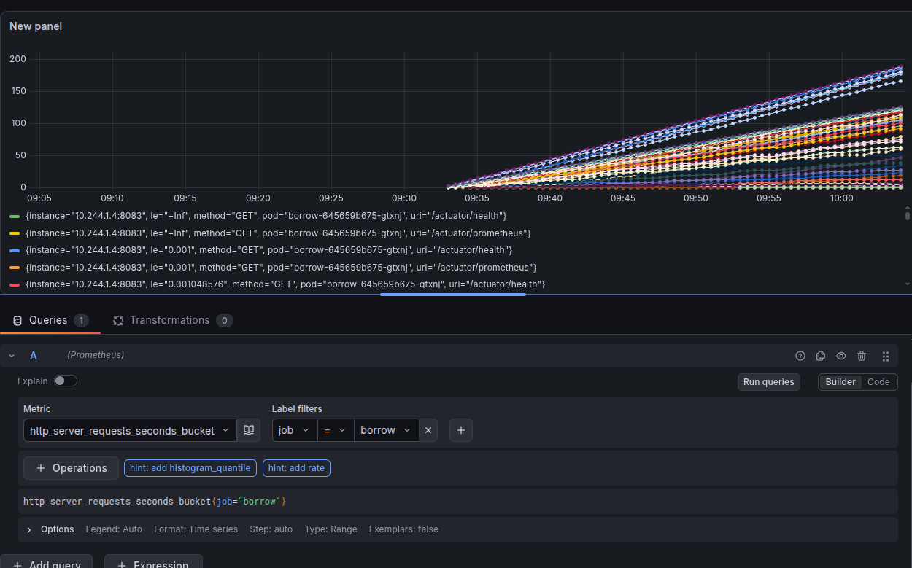

---

## 🚀 Continuous Delivery Pipeline


An end-to-end automated delivery pipeline ensuring code reliability, automated project management, and seamless container publishing from commit to production.

### 🔄 Workflow Overview

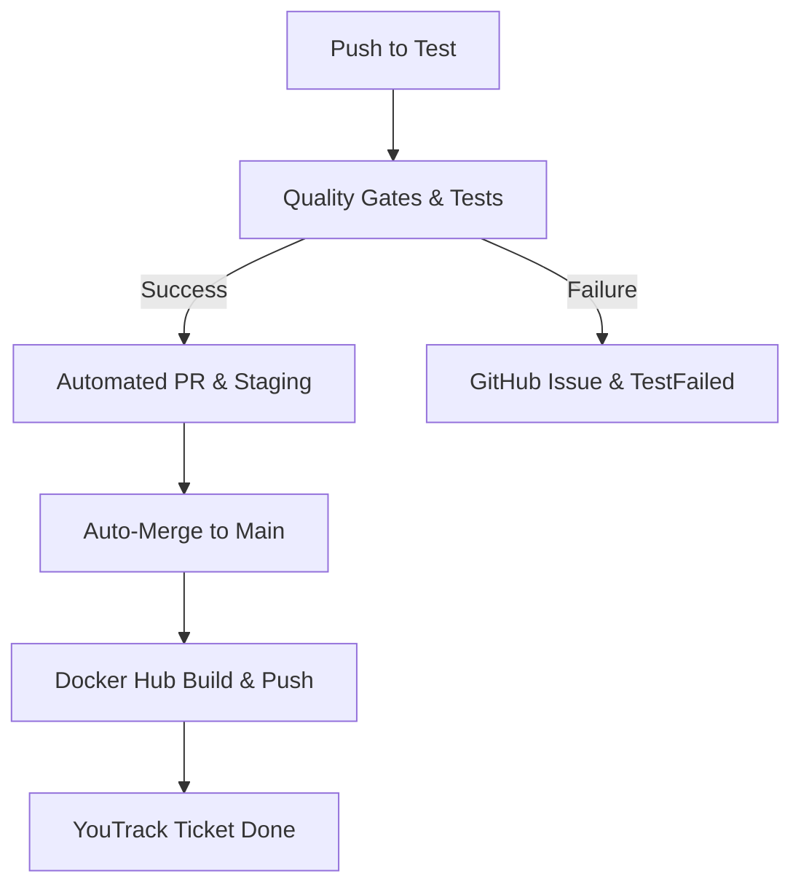

### 1. 🧪 Quality Gates & Validation

Executes unit tests and integration tests using JDK 21 to ensure correctness across isolated logic and system interactions.

**On failure:**

- Automatically creates a GitHub Issue.
- Moves the corresponding YouTrack ticket to `TestFailed`.

### 2. 🤖 Promotion Logic

**On success:**

- Creates a Pull Request targeting `main`.
- Applies the `Staging` and `TestsPassed` labels.
- Moves the YouTrack ticket to `Staging`.
- Automatically merges the Pull Request.

This enables a fully automated, label-driven workflow.

### 3. 📦 Immutable Releases & Registry Sync

Retrieves the exact Git SHA from workflow artifacts and tags the Docker image to ensure 1:1 traceability between source code and deployment artifacts.

Builds and publishes the production-ready image to Docker Hub.

### 4. ✅ Finalization

Automatically moves the YouTrack ticket to `Done`, closing the delivery loop.

This ensures end-to-end automation from commit to delivery.

---

## 🔄 Borrow Flow

This diagram illustrates the business flow when a user borrows a book.

The request is processed by the Borrow Service, which validates the operation and publishes an event to Kafka.

Other services then react asynchronously to update their respective domains.


---

## ⏳ Eventual Consistency Flow

This diagram illustrates how the system achieves eventual consistency using an event-driven architecture.

When a user performs a borrowing operation, the system responds immediately while propagating changes asynchronously across multiple services via Kafka.

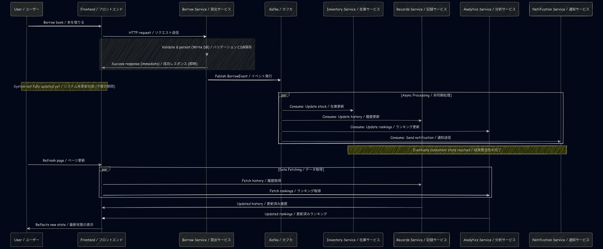

---

## 🧠 Engineering Takeaways

- Designing for eventual consistency changes how you think about data ownership and synchronization.
- Event-driven systems require strong observability.
- Decoupling services improves scalability but increases architectural complexity.

---

## ⚖️ Architectural Trade-offs

Every architectural decision introduces benefits but also compromises. This project intentionally embraces several trade-offs to demonstrate production-grade patterns.

| Decision | Benefit | Trade-off |
|:---------|:--------|:----------|
| **Kafka** | Loose coupling | Eventual consistency |
| **Local Projections** | Consumer autonomy | Data duplication |
| **Kubernetes** | Scalability | Operational complexity |
| **CQRS** | Optimized read models | More infrastructure |
| **Managed Databases** | Stateless application pods | Network latency |

---

### 🚀 Summary

This project demonstrates a production-inspired distributed system implementing real-world architectural patterns such as CQRS, event-driven design, and microservices.

---

## 👤 Author

<p align="center">

Built as a portfolio project to demonstrate modern backend engineering practices.

<br/>

Made with ❤️ by <b>Damou</b>

<br/>

<a href="https://github.com/damouu">GitHub</a> •
<a href="https://www.linkedin.com/">LinkedIn</a>

<br/>

Backend & Platform Engineer

</p>
